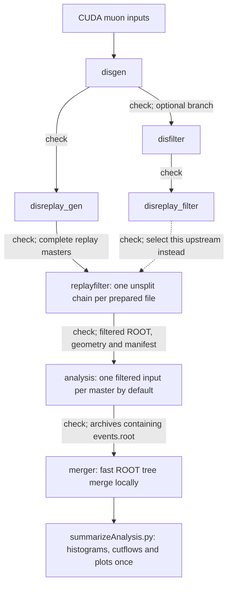

# MuonDIS production workflow

Configure a campaign once in `workflow.yaml`, then submit/check one stage at a
time. Use this directory's `gangaSubmit.sh` for this workflow; the root
`../gangaSubmit.sh` is the legacy launcher. There is no legacy CLI/configuration
translation.



See the [detailed workflow and output layout](../production/directory-structure.md)
for checker exports, replayfilter outputs and analysis splitting.

Only disgen discovers files. Every subsequent stage consumes the saved output
list from its upstream checker. Submission uses saved entry counts and cheap
file size/mtime checks; it does not reopen ROOT metadata or rediscover EOS files.
FairShip executables still perform their own physics/provenance validation when
they run. Changing files after checking requires a fresh check.

## Start a campaign

Edit `workflow.yaml` first: choose a new `production` name, output location and
FairShip installation. The examples contain the current geometry/map paths;
review them for the new production. Relative paths resolve beside their YAML,
not against the shell's working directory. Common values can be overridden in
a stage YAML. Commented settings show defaults; active values are examples or
the settings most likely to change. `options` accepts the corresponding
FairShip executable's physics flags; `null`/`false` suppress a flag, while a list
provides multiple arguments. Input, output and range flags are reserved.

From this directory:

```bash
./gangaSubmit.sh disgen.yaml --test                  # preview; no Ganga Job created
./gangaSubmit.sh disgen.yaml --test --verbose        # readable task JSON + interactive commands
./gangaSubmit.sh disgen.yaml --test --submit
./gangaSubmit.sh status disgen.yaml --test
./gangaSubmit.sh check disgen.yaml --test --metadata

# After each stage's check succeeds:
./gangaSubmit.sh disreplay_gen.yaml --test --submit
./gangaSubmit.sh check disreplay_gen.yaml --test
./gangaSubmit.sh replayfilter.yaml --test --submit
./gangaSubmit.sh check replayfilter.yaml --test
./gangaSubmit.sh analysis.yaml --test --submit
./gangaSubmit.sh check analysis.yaml --test
./gangaSubmit.sh merger.yaml --test --submit
```

Omit `--test` for production, starting again at disgen. Test and production have
different state and output directories. A test selects one input/master and
at most 100 entries (2 for replay); it never reads a production checker export.
The merger and its subsequent summary run locally in the FairShip Pixi environment,
not as Ganga jobs.
Checks also run there automatically when called through `gangaSubmit.sh`.

From the repository root, prepend `prodWorkflow/` to both the launcher and the
YAML filename. Offline planning/help needs Python + PyYAML only:

```bash
python3 prodWorkflow/workflow.py plan prodWorkflow/disgen.yaml --test --verbose
./prodWorkflow/gangaSubmit.sh --help
./prodWorkflow/gangaSubmit.sh plan --help
./prodWorkflow/gangaSubmit.sh check --help
./prodWorkflow/gangaSubmit.sh retry --help
./prodWorkflow/gangaSubmit.sh merge --help
```

`python3 workflow.py status FILE.yaml` displays saved statuses; the Ganga
launcher polls the backend for the recorded jobs before saving their statuses.
Ganga batch scripts normally disable automatic monitoring; reading the repository
alone can therefore leave finished jobs marked `submitted`. `status` succeeds
even while some jobs are unfinished; `check` exports valid completed ranges and
returns nonzero until every recorded range passes. Direct Python checks/merges
must be run in FairShip's environment. No CLI options override YAML physics,
resources or splitting. The CLI contains action flags only.

For a parallel campaign, use a distinct `tag` or `production` in a separate
shared YAML and set `workflow: workflow_26.yaml` in **every** corresponding stage
YAML. The filename suffix alone does not select the shared configuration.
The supplied `_26.yaml` stages use `workflow_26.yaml` throughout.

Repeated `--test --submit` commands keep the first input and do not duplicate an
existing attempt. When no work is selected, the preview lists the recorded test
job IDs. Inspect it with `status disgen_26.yaml --test`, then run
`check disgen_26.yaml --test --metadata`; use `retry disgen_26.yaml --test --submit`
only for checker-rejected terminal ranges. A fresh independent test requires a
new campaign or step `name`.

## Checks and next-step inputs

Each submitted stage stores these files under
`STATE_DIR/TAG/PRODUCTION/{production,test}/STEP_NAME/`:

| File | Purpose |
| --- | --- |
| `state.json` | Frozen settings/plans, exact Ganga IDs, per-range attempts and live status snapshots |
| `checked.json` | Successful/rejected ranges, cached metadata/counts, and the approved next-step input list |
| `tasks/ATTEMPT/task-UNIT.json` | Exact worker command settings, sources and expected outputs |
| `preview/task-UNIT.json` | Readable interactive task files written by `--verbose` |

The checker uses the existing `checkPrepareEventsOutputs`, `checkFilterOutputs`,
`checkReplay`, `checkReplayFilter` and `checkAnalysis` parsing/validation helpers.
It prints stage counts, available material statistics, replay hit restoration,
filter efficiency, job timings and failures. `--metadata` additionally prints
deduplicated preparation normalization. `check disgen.yaml --check-root` reads
the detailed ROOT statistics, including weighted muons/material totals.
Default checks read ROOT headers, not event baskets. Successful unchanged
checks are cached; `--refresh` forces validation again. Log/transfer/output
changes invalidate the relevant cached result.

No consecutive ID range is assumed. Repairs and unrelated Ganga jobs can have
interleaved IDs. Outputs are accepted only when the log, exact transfer paths,
file identities and preparation metadata pass. Analysis additionally checks
archive contents/provenance. Replayfilter receives a complete logical replay
master only after **every planned range** succeeds, even if repaired ranges
belong to newer Ganga jobs. Individual successful disgen/disfilter outputs are
listed separately. Empty valid ROOT trees are distinguished from missing files;
replay skips zero-entry prepared inputs.

By default `require_complete: true` waits for every planned upstream range.
Set `require_complete: false` in the receiving YAML to explicitly use only
approved upstream outputs. Incomplete replay masters remain excluded either
way. Newly checked upstream outputs are appended when planning subsequent
batches; previously submitted groups are never silently regrouped. If a saved
group's inputs change, use a new campaign/step name rather than mixing them.

`n_jobs` limits how many new masters are planned and recorded per submission.
For example, `n_jobs: 1`, `events_per_file: 250000` and
`events_per_subjob: 10000` select one input and create 25 subjobs. Only selected
inputs are fingerprinted and expanded into tasks; disgen still lists matching
paths to select inputs in a stable sorted order. Repeat the ordinary submission
command to select the next inputs, skipping groups already recorded.
The checker covers recorded submission batches, not the entire input directory.
Old pre-assigned groups with no submission attempt are removed automatically;
every group with an attempt retains all its ranges, including unfinished ones.

## Failed ranges

```bash
./gangaSubmit.sh check disreplay_gen.yaml
./gangaSubmit.sh retry disreplay_gen.yaml --verbose
./gangaSubmit.sh retry disreplay_gen.yaml --submit
./gangaSubmit.sh check disreplay_gen.yaml
```

`retry` selects checker-rejected ranges whose live Ganga status is terminal
(`failed`, `killed`, or `completed` with invalid outputs). Successful ranges are
not repeated. Running, held, missing/unknown, or ambiguously submitted jobs
are not automatically retried. Resolve their status in Ganga first; then check
and retry. A submission exception is recorded before it propagates, including
the reserved job ID. IDs are saved **before** calling `job.submit()`.

Each attempt writes to a unique directory:

```text
OUTPUT_BASE/TAG/PRODUCTION/MODE/STEP_NAME/GROUP/ATTEMPT/RANGE/output-file
```

Retries do not delete or overwrite earlier output. Only the newest accepted
attempt contributes to a logical range. State is written atomically under a
per-step lock. After an interrupted launcher, inspect the lock's `owner.json`
and remove the lock directory only after confirming that process has stopped.

Keep the state directory and Ganga repository: they provide the job identities,
input provenance and sandbox files. Runtime resources and `n_jobs` may change;
physics/input/splitting changes after submission require a new production or
step `name`. Do not manually resubmit old attempts once downstream production
has consumed their outputs; use the workflow's fresh-attempt retry instead.

## Optional filtered branch

Run/check `disfilter.yaml` after disgen, then run/check
`disreplay_filter.yaml`. To consume this branch, set
`upstream: disreplay_filter` in `replayfilter.yaml` before its first submission.
Analysis infers the replay type from that export.

To run both branches in one campaign, copy `replayfilter.yaml`, `analysis.yaml`
and `merger.yaml`, give the copies different `name` values and connect their
`upstream` names. For example:

```text
replayfilter_filter: step=replayfilter, upstream=disreplay_filter
analysis_filter:     step=analysis,     upstream=replayfilter_filter
merger_filter:       step=merger,       upstream=analysis_filter
```

## Disk space, merging and interactive diagnosis

Analysis defaults to one replayfilter master per Ganga master. Set
`events_per_subjob` in `analysis.yaml` to split further. The default
`analysis.tree_only: true` extracts version-7 `events.root`, containing the `DIS`
TTree with one entry per filtered replay event, plus `normalization.csv` and the
small completion/provenance manifest `run.json`. Jobs defer histogram filling
and plot rendering. All outputs still transfer in one `analysis_evt*.tar.gz`.
`disk_mb` makes the disk request explicit, but the batch site's maximum still
applies. The setting is a request, not a guarantee of usable quota.

`merger.yaml` now defaults to `skip_event_records: false` and `summarize: true`.
It unpacks the checked archives and invokes FairShip's `mergeAnalysis.py`, which
validates tree schemas, entry counts and small provenance/stage branches, then
copies compressed ROOT baskets without decoding/re-encoding the track/hit payload.
It then runs `summarizeAnalysis.py` on the merged tree to fill histograms,
per-stage/per-material cutflows, pair/tagger summaries and normalization once.
The default destinations are `merger/merged` for the tree and manifest,
`merger/merged_summary` for summaries and plots, and `merger/merged_inputs` for
retained unpacked inputs. Original archives remain available. Archive unpacking
still takes I/O; summarizing still reads the events and fills histograms.

Set `save_plots: false` in `merger.yaml` to write summaries without rendering.
Set `summarize: false` to perform only the tree merge. To summarize later (or
retry a failed summary), run from the FairShip installation:

```bash
pixi cvmfs python -u newMuonDIS/summarizeAnalysis.py /path/to/merged \
    --output-dir /path/to/new_summary --no-plots
```

The merge is recorded before summarization, so a summary failure leaves the
merged tree available. Choose a new/empty summary directory for the retry;
rerunning the whole merger into the existing merge destination is rejected.
Omit `--no-plots` to render plots. Use the same FairShip analysis code for
extraction and summary; selection-code changes require re-extraction.

For combined tree/histogram jobs, set `analysis.tree_only: false`. Those outputs
merge directly, without a separate summary invocation; only that mode supports
`skip_event_records: true` to omit `events.root`. Tree-only and combined outputs
cannot be mixed. Version-5/6 JSON outputs must be regenerated for the current
FairShip merger. Use fresh analysis and merger step names (and connect their
`upstream` values) or a new campaign when changing an existing production to
version 7; checked replayfilter inputs can be reused.

Merge and summary destinations must be new/empty. Partial merges require
`require_complete: false`; state records the exact input archives and, after a
successful summary, its output directory. Archive checks validate structure and
manifests without opening ROOT; the merger performs tree validation.

`--verbose` prints a fresh-directory interactive command for each planned task.
The task JSON contains ordinary paths and arguments, with no base64 payload.
The worker prints its direct `pixi-cvmfs ... python3 -u -X faulthandler ...`
command and streams stdout/stderr. For analysis, append `--prepare-only` to the
interactive worker command to create the readable analysis config/input links
and print the direct FairShip command without running it. Edit a **copy** of a
task JSON to reduce `count` and the matching `--n-events`/`-n` argument.

## Validation

```bash
python3 -B -m unittest discover -s prodWorkflow/tests -v
bash -n gangaSubmit.sh prodWorkflow/gangaSubmit.sh
```

The workflow tests use temporary local files and a fake Ganga API. They cover
checked-only inputs, finite splitting, metadata caching, complete replay groups,
nonconsecutive job IDs, failed-range repair, durable submission reservations,
test isolation, readable workers, version-7 archives, tree retention/omission and
the merge-to-summary handoff. They do not run simulation
or submit jobs. Real FairShip/Condor smoke testing remains an explicit test
campaign using the commands above.
