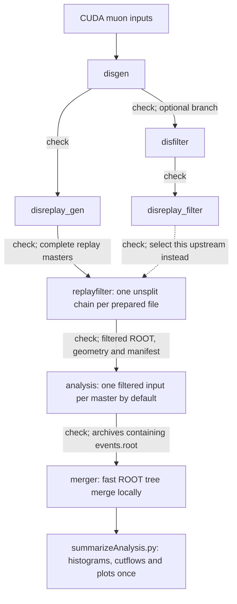

# MuonDIS production workflow

Configure a campaign once in `workflow.yaml`, then submit/check one stage at a
time. Use this directory's `gangaSubmit.sh` for this workflow; the root
`../gangaSubmit.sh` is the legacy launcher. There is no legacy CLI/configuration
translation.

Workflow helpers are local copies in this directory: the stage checkers,
`jobTiming.py`, `productionState.py`, `preparationInputs.py`, `replayProduction.py`,
`gangaProdScript.py` (executable-option validation), and the worker helpers
`wn_script_pixi.py`, `replayfilter_worker.py`, `replayChain.py`, and
`replayDiagnostics.py`. Imports and
new Ganga input sandboxes use these copies; the originals in the parent
directory are independent and are not modified. FairShip executables still
come from the configured `fs_install`. Existing submitted jobs retain their
original input sandboxes.

The local disgen checker accepts both the older UBT diagnostics and the newer
UBT scoring-plane/shield-exit wording, including weighted diagnostics. It keeps
backward-path statistics for the two origins separate and still rejects missing
or duplicate diagnostic blocks.
The summary also reports input companion muons and events with at least two
muons, before momentum/path/DIS selection. For older multiplicity logs, companion
counts are `sum(n_mu) - events with n_mu >= 2`; newer logs provide them directly.
Logs without either counter are reported as unavailable, not zero. Newer logs
also supply inclusive input multiplicity and counts discarded for having no DIS
in the selected materials. Multiplicity averages use combined totals.



See the [detailed workflow and output layout](../production/directory-structure.md)
for checker exports, replayfilter outputs and analysis splitting.

Only disgen discovers files. Every subsequent stage consumes the saved output
list from its upstream checker. Submission uses saved entry counts and cheap
file size/mtime checks; it does not reopen ROOT metadata or rediscover EOS files.
FairShip executables still perform their own physics/provenance validation when
they run. Changing files after checking requires a fresh check.

## Start a campaign

Edit `workflow.yaml` first: choose a new `production` name, output location,
FairShip installation and `geometry_file`. The shared geometry is passed as
`--geoFile` to disgen/disfilter, `--geofile` to disreplay, and as the geometry
override to replayfilter and analysis. Merger inherits the setting but publishes
the checked replayfilter companion geometry to preserve its input provenance.
Set `geometry_file` in an individual stage YAML only for a deliberate override;
do not put geometry flags in `options`. Review map paths for the new production.
Relative paths resolve beside their YAML,
not against the shell's working directory. Common values can be overridden in
a stage YAML. Commented settings show defaults; active values are examples or
the settings most likely to change. `options` accepts the corresponding
FairShip executable's physics flags; `null`/`false` suppress a flag, while a list
provides multiple arguments. Input, output and range flags are reserved.

Set `options.--require-sbt-hit: true` near the top of `disgen.yaml` (or
`disgen_26.yaml`) to select only input muons with at least one SBT hit belonging
to the selected primary muon. The default is `false`; enabling it passes
`--require-sbt-hit` to `prepareEvents.py`. Use a new stage name or production
when changing this selection after planning jobs.

Select DIS categories with `options.--materials`, using a YAML list such as
`--materials: [HE, HeBalloon]`. Uncomment and edit the examples in the `disgen`
and `disreplay_gen`/`disreplay_filter` YAMLs to choose a subset. Valid categories
are `MS`, `UBT`, `SBTsens`, `SBTfr`, `SSTsens`, `SSTfr`, `HE`, `AIR`, `HeBalloon`,
`REST` and `SBTss`. With the option omitted (or `null`), generation uses all
categories except `REST`, while replay uses all stored categories. Replay can
select a subset of the generated interactions; it cannot add missing ones.
Replayfilter and analysis use the stored interactions and need no materials option.

New `disgen` submissions default to a reproducible seed derived from `production`
in the shared workflow YAML and the Ganga master/subjob IDs. For numeric
production dates, recalculate it with Python integer arithmetic:

```python
pair = (master + subjob) * (master + subjob + 1) // 2 + subjob
seed = (int(production) + pair) % 899999999 + 1
```

An unsplit job uses `subjob = 0`. Named productions use
`zlib.crc32(str(production).encode('utf-8'))` instead of `int(production)`.
Distinct master/subjob pairs within one production cannot collide provided
`pair < 899999999`; submission rejects larger pairs instead of wrapping them.
This is not a global uniqueness guarantee across production values or separate
Ganga repositories. Seeds always lie in Pythia6's supported range 1–899999999.
The submitted task JSON records the seed and its inputs, and the worker logs
them before running `prepareEvents.py --seed SEED`. A workflow retry creates a
new Ganga master and seed; rerunning the same saved task preserves its seed.

Leave `options.--seed` omitted for this default. Set it to a fixed integer to
override it (the same value for every range), or to `null` for time-based seeds.
Existing submitted tasks are unchanged. Preview tasks have no Ganga ID yet;
for reproducible interactive runs, use a submitted task JSON under
`STEP_STATE_DIR/tasks/ATTEMPT_ID/` or specify a fixed seed in the YAML.

From this directory:

```bash
./gangaSubmit.sh disgen_26.yaml --checkInputs        # inspect input trees and exit
./gangaSubmit.sh disgen.yaml --test                  # preview; no Ganga Job created
./gangaSubmit.sh disgen.yaml --test --verbose        # readable task JSON + interactive commands
./gangaSubmit.sh disgen.yaml --test --submit
./gangaSubmit.sh status disgen.yaml --test
./gangaSubmit.sh check disgen.yaml --test --metadata

# After each stage's check succeeds:
./gangaSubmit.sh disreplay_gen.yaml --test --submit
./gangaSubmit.sh check disreplay_gen.yaml --test
./gangaSubmit.sh replayfilter.yaml --test --submit
./gangaSubmit.sh check replayfilter.yaml --test
./gangaSubmit.sh analysis.yaml --test --submit
./gangaSubmit.sh check analysis.yaml --test
./gangaSubmit.sh merger.yaml --test --submit
```

Omit `--test` for production, starting again at disgen. Test and production have
different state and output directories. A test selects one input/master and
at most 100 entries (2 for replay); it never reads a production checker export.
The merger and its subsequent summary run locally in the FairShip Pixi environment,
not as Ganga jobs.
Checks also run there automatically when called through `gangaSubmit.sh`.

`--checkInputs` runs the standalone `checkInputs.py` without starting Ganga or
creating state, task files or output directories. It scans all inputs using the
same pattern and exclusions as disgen, ignoring job and event limits. The compact
table groups files with identical top-level TTree names and entry counts (the
counts correspond to the listed names). It reads tree headers only and lists
files with missing/empty `cbmsim` trees or unreadable ROOT files. Exit status is
1 for those problems or no matching files, otherwise 0. PyROOT is used locally
when available, with the configured FairShip environment as a fallback.
Direct invocation: `python3 -B checkInputs.py disgen_26.yaml`.

From the repository root, prepend `prodWorkflow/` to both the launcher and the
YAML filename. Offline planning/help needs Python + PyYAML only:

```bash
python3 prodWorkflow/workflow.py plan prodWorkflow/disgen.yaml --test --verbose
./prodWorkflow/gangaSubmit.sh --help
./prodWorkflow/gangaSubmit.sh plan --help
./prodWorkflow/gangaSubmit.sh check --help
./prodWorkflow/gangaSubmit.sh retry --help
./prodWorkflow/gangaSubmit.sh merge --help
```

`python3 workflow.py status FILE.yaml` displays saved statuses; the Ganga
launcher polls the backend for the recorded jobs before saving their statuses.
Ganga batch scripts normally disable automatic monitoring; reading the repository
alone can therefore leave finished jobs marked `submitted`. `status` succeeds
even while some jobs are unfinished; `check` exports valid completed ranges and
returns nonzero until every recorded range passes. Direct Python checks/merges
must be run in FairShip's environment. No CLI options override YAML physics,
resources or splitting. The CLI contains action flags only.

For a parallel campaign, use a distinct `tag` or `production` in a separate
shared YAML and set `workflow: workflow_26.yaml` in **every** corresponding stage
YAML. The filename suffix alone does not select the shared configuration.
The supplied `_26.yaml` stages use `workflow_26.yaml` throughout.

Repeated `--test --submit` commands keep the first input and do not duplicate an
existing attempt. When no work is selected, the preview lists the recorded test
job IDs. Inspect it with `status disgen_26.yaml --test`, then run
`check disgen_26.yaml --test --metadata`; use `retry disgen_26.yaml --test --submit`
only for checker-rejected terminal ranges. A fresh independent test requires a
new campaign or step `name`.

## Checks and next-step inputs

Each submitted stage stores these files under
`STATE_DIR/TAG/PRODUCTION/{production,test}/STEP_NAME/`:

| File | Purpose |
| --- | --- |
| `state.json` | Frozen settings/plans, exact Ganga IDs, per-range attempts and live status snapshots |
| `checked.json` | Successful/rejected ranges, cached metadata/counts, and the approved next-step input list |
| `tasks/ATTEMPT/task-UNIT.json` | Exact worker command settings, sources and expected outputs |
| `preview/task-UNIT.json` | Readable interactive task files written by `--verbose` |

The checker uses the existing `checkPrepareEventsOutputs`, `checkFilterOutputs`,
`checkReplay`, `checkReplayFilter` and `checkAnalysis` parsing/validation helpers.
It prints stage counts, available material statistics, replay hit restoration,
filter efficiency, job timings and failures. `--metadata` additionally prints
deduplicated preparation normalization. `check disgen.yaml --check-root` reads
the detailed ROOT statistics, including weighted muons/material totals.
To inspect individual normalization records in one replayfilter ROOT file, run
`python3 printNormalization.py /path/to/replayfilter.root` with ordinary Python
and `uproot` (`python3 -m pip install uproot`); ROOT and FairShip are not needed.
It reads only metadata and prints one row per record with its identifier, stage,
`input_muons` and `sum_weights`; use `--tree MuonDIS` for preparation outputs.
Replay and replayfilter checks validate the total plus all ten material
`muon_path_length*` branches as scalar doubles, including zero-entry outputs.
Legacy files with no path-length branches remain usable and are reported;
partial sets and wrong branch types fail. Filtering retains these branches
and records their presence in its manifest.
Replayfilter workers also save all-event selection diagnostics by default under
`replay_sources/<index>/replayFilterDiagnostics`, with per-muon summaries and
acceptance plots beside each source's copied metadata. Set `diagnostics: false`
in the replayfilter YAML to omit them.

`--check-root` also works for `disreplay_gen`, `disreplay_filter`, `replayfilter`
and replay `analysis`. It scans only scalar path lengths, rejecting negative
or non-finite replay values, and prints availability, means and maxima in cm.
These are unweighted **replay-event** statistics: each incoming muon's length
is repeated for its DIS events. The total excludes REST; MS is the restricted
shield sampling path. Analysis checks additionally unpack `events.root` into
temporary storage and validate its entry count and full schema against
`fs_install/newMuonDIS/analysisTree.py`, including entrance-window diagnostics.
Analysis NaNs mean unavailable lengths; zero is a measured zero. The analysis
total is named `muon_path_length_total`. Tree-only and histogram modes retain
the same path-length branches. Mixed event-record diagnostic schemas cannot
be checked/merged together, even when both outputs say version 7.

Default replay checks read ROOT headers, not event baskets; default analysis
checks validate the archive and manifest. Successful unchanged
checks are cached; `--refresh` forces validation again. Log/transfer/output
changes and checker-version changes invalidate the relevant cached result.

No consecutive ID range is assumed. Repairs and unrelated Ganga jobs can have
interleaved IDs. Outputs are accepted only when the log, exact transfer paths,
file identities and preparation metadata pass. Analysis additionally checks
archive contents/provenance. Replayfilter receives a complete logical replay
master only after **every planned range** succeeds, even if repaired ranges
belong to newer Ganga jobs. Individual successful disgen/disfilter outputs are
listed separately. Empty valid ROOT trees are distinguished from missing files;
replay skips zero-entry prepared inputs.

By default `require_complete: true` waits for every planned upstream range.
Set `require_complete: false` in the receiving YAML to explicitly use only
approved upstream outputs. Incomplete replay masters remain excluded either
way. Newly checked upstream outputs are appended when planning subsequent
batches; previously submitted groups are never silently regrouped. If a saved
group's inputs change, use a new campaign/step name rather than mixing them.

`n_jobs` limits how many new masters are planned and recorded per submission.
For example, `n_jobs: 1`, `events_per_file: 250000` and
`events_per_subjob: 10000` select one input and create 25 subjobs. Only selected
inputs are fingerprinted and expanded into tasks; disgen still lists matching
paths to select inputs in a stable sorted order. Repeat the ordinary submission
command to select the next inputs, skipping groups already recorded.
The checker covers recorded submission batches, not the entire input directory.
Old pre-assigned groups with no submission attempt are removed automatically;
every group with an attempt retains all its ranges, including unfinished ones.

For `disreplay_gen`, one master consumes one checked output from a disgen
subjob. Set the following in `disreplay_gen.yaml` (or `disreplay_gen_26.yaml`)
to replay at most five new disgen subjob outputs per invocation:

```yaml
n_jobs: 5
events_per_subjob: 500
```

Each selected file is still split into replay subjobs of up to 500 entries, so
this can create more than five replay subjobs. Repeating submission selects the
next five unsubmitted inputs; `n_jobs: -1` selects all available inputs. Empty
disgen outputs are skipped. To start before all disgen ranges finish, also set
`require_complete: false` and run the disgen checker first; only checker-approved
outputs are eligible. `--test` always selects at most one input and two entries.

For a replayfilter smoke run on production replay outputs, use
`./gangaSubmit.sh replayfilter_smoke.yaml --submit` without `--test`.
It uses a separate step name and processes at most 10,000 entries from one
checked replay master per invocation. `events_per_file` caps the entire chain;
the default `-1` processes all entries. Replayfilter still requires one unsplit
chain starting at entry zero.

## Failed ranges

```bash
./gangaSubmit.sh check disreplay_gen.yaml
./gangaSubmit.sh retry disreplay_gen.yaml --verbose
./gangaSubmit.sh retry disreplay_gen.yaml --submit
./gangaSubmit.sh check disreplay_gen.yaml
```

`retry` selects checker-rejected ranges whose live Ganga status is terminal
(`failed`, `killed`, or `completed` with invalid outputs). Successful ranges are
not repeated. Running, held, missing/unknown, or ambiguously submitted jobs
are not automatically retried. Resolve their status in Ganga first; then check
and retry. A submission exception is recorded before it propagates, including
the reserved job ID. IDs are saved **before** calling `job.submit()`.

Each attempt writes to a unique directory:

```text
OUTPUT_BASE/TAG/PRODUCTION/MODE/STEP_NAME/GROUP/ATTEMPT/RANGE/output-file
```

Retries do not delete or overwrite earlier output. Only the newest accepted
attempt contributes to a logical range. State is written atomically under a
per-step lock. After an interrupted launcher, inspect the lock's `owner.json`
and remove the lock directory only after confirming that process has stopped.

Keep the state directory and Ganga repository: they provide the job identities,
input provenance and sandbox files. Runtime resources and `n_jobs` may change;
physics/input/splitting changes after submission require `rerun` or a new production
or step `name`. Do not manually resubmit old attempts once downstream production
has consumed their outputs; use the workflow's fresh-attempt retry instead.

## Rerun a step with the same name

After changing the selection or settings, rerun all eligible inputs of one
production step using its existing YAML and name:

```bash
./gangaSubmit.sh rerun replayfilter.yaml              # Preview; keep saved state
./gangaSubmit.sh rerun replayfilter.yaml --submit     # Reset this step and submit
./gangaSubmit.sh check replayfilter.yaml
```

`rerun --submit` replaces only that step's `state.json` with a fresh plan and
removes its `checked.json`. Planning must succeed before either record changes.
It reuses the upstream checker's approved inputs without changing upstream
state or jobs. It accepts changed YAML settings and ignores previous successes
for the selected step. `n_jobs` still limits the submitted batch; use normal
`FILE.yaml --submit` commands to continue that fresh run without resetting it
again. `--test` resets only the test namespace.

Previous output files, task sandboxes and Ganga jobs remain in place. New jobs
use fresh attempt directories. The command does not cancel any running jobs or
reset downstream steps. Downstream outputs still describe their original inputs;
rerun those steps separately after checking the new outputs when needed.
The local `merge` command still requires a new or empty output destination.

## Optional filtered branch

Run/check `disfilter.yaml` after disgen, then run/check
`disreplay_filter.yaml`. To consume this branch, set
`upstream: disreplay_filter` in `replayfilter.yaml` before its first submission.
Analysis infers the replay type from that export.

To run both branches in one campaign, copy `replayfilter.yaml`, `analysis.yaml`
and `merger.yaml`, give the copies different `name` values and connect their
`upstream` names. For example:

```text
replayfilter_filter: step=replayfilter, upstream=disreplay_filter
analysis_filter:     step=analysis,     upstream=replayfilter_filter
merger_filter:       step=merger,       upstream=analysis_filter
```

## Disk space, merging and interactive diagnosis

Analysis defaults to combining all checked replayfilter masters into one Ganga
job (`masters_per_job: -1`). Set this top-level option to a positive batch size
to limit the number of upstream masters per chain, or `1` for the previous
per-master behavior. The defaults for one job processing every entry are:

```yaml
masters_per_job: -1
first_event: 0
events_per_file: -1
events_per_subjob: null
n_subjobs: null
```

Entry limits and splitting apply to each combined chain. `n_jobs` limits the
number of grouped Ganga masters submitted per invocation; it does not limit
the number of input masters in a group. Normalization metadata is read from
every input and deduplicated by the analysis code. Checked file identities and
upstream record IDs are retained in the plan. Repeated submissions group only
new, unassigned inputs; existing groups keep their original membership.
`require_complete: true` (the default) waits for the entire upstream step;
`--test` still uses only the first upstream master and at most 100 entries.
Changing grouping for an existing analysis step requires a new `name` or `rerun`.
To reprocess everything together, including masters already successfully
analyzed, run:

```bash
./gangaSubmit.sh rerun analysis.yaml             # Preview all checked masters in one job.
./gangaSubmit.sh rerun analysis.yaml --submit    # Reprocess all of them with fresh output paths.
```

Use `analysis_26.yaml` for that campaign. `rerun` resets the analysis plan and
includes every checked upstream master regardless of previous analysis status.
The equivalent `--rerun` option also works with the YAML-first command:

```bash
./gangaSubmit.sh analysis_26.yaml --rerun           # Preview; keep saved state.
./gangaSubmit.sh analysis_26.yaml --rerun --submit  # Reset analysis and submit fresh jobs.
./gangaSubmit.sh check analysis_26.yaml            # After the new jobs finish.
```

This reuses checked replayfilter inputs and preserves previous output files.
Rerun the merger separately with a new or empty destination if needed.
The replayfilter YAMLs set `cross_section: analytical` to replace the scalar
`cbmsim.muDIS_xsec` branch with `0.0000599 + 0.0002839 * log(muDIS_pPythia / 2)**2`
in mb (natural log, momentum in GeV/c). Original MCTrack weights and normalization
are retained. Omitting this setting, or using `stored`, preserves the input branch.
The worker records the mode in both ROOT provenance and its checked manifest.

The analysis YAMLs use `analysis.cross_section: stored` and `weight_factor: 1`
to consume that branch. DIS weights acquire `muDIS_xsec * 6.02214076e-4` once;
soft weights retain their existing treatment. Summary replay uses the same saved
cross section. Missing/invalid values, including the old `-1` placeholder, fail
stored analysis. For older replayfilter outputs, use `analytical` to compute at
analysis time or rerun replayfilter with the new mode.
`constant` (the default when omitted) retains legacy weight-factor-only analysis.
To change a saved stage's cross-section setting, use `--rerun` or a new stage name
or production, as with other physics settings. Update FairShip's `replayFilter.py`,
`analyseEvents.py` and `analysisTree.py` together with these workflow scripts.
To continue an existing per-master analysis without changing its grouping,
explicitly set `masters_per_job: 1`.

Set `events_per_subjob` to split a chain further. The default
`analysis.tree_only: true` extracts version-8 `events.root`, containing the `DIS`
TTree with one entry per filtered replay event, plus `normalization.csv` and the
small completion/provenance manifest `run.json`. Jobs defer histogram filling
and plot rendering. All outputs still transfer in one `analysis_evt*.tar.gz`.
`disk_mb` makes the disk request explicit, but the batch site's maximum still
applies. The setting is a request, not a guarantee of usable quota.

`merger.yaml` now defaults to `skip_event_records: false`, `summarize: true`
and `save_plots: false`.
Both merger YAMLs also enable `merge_replayfilter: true`. This adds a full
`cbmsim` merge of the replayfilter files referenced by the checked analysis
manifests. Each filtered file is included once, even if multiple analysis jobs
used it, and zero-entry files still contribute metadata. These are **whole
filtered files**: when analysis processed only some ranges, the replayfilter
merge contains more entries than the merged analysis tree.

The preview prints the input count and exact publication directory. The new
bundle is built and retained locally at
`results/TAG/PRODUCTION/MODE/NAME/replayfilter_merged/` beside the YAML. It contains:

- `replayfilter_merged.root`: one `cbmsim` tree with all original branches,
  including stored analytical `muDIS_xsec` and original MCTrack weights.
- `geo_replayfilter_merged.root`: a copy of the first planned input's geometry.
  Only this geometry is loaded; all inputs are assumed to share the geometry
  configured for replay filtering.
- `replayfilter_merged.json`: input identities, entry offsets, aggregate filter
  counts, deduplicated normalization and output sizes/SHA-256 checksums.

Inside the merged ROOT file, `diagnostics/` contains the combined
`replayFilterDiagnostics` and `replayFilterMuons` trees and
`replayFilterPlots/MATERIAL/` histograms. Accepted-event `selected_entry` values
are shifted to refer to the merged `cbmsim`; rejected events retain `-1`.
Original source UUIDs/entry numbers remain available. Muon rows retain the
original grouping by source UUID and muon entry. Count histograms, including
underflow/overflow and their errors, are summed; efficiencies and binomial
errors are recalculated from combined accepted/all counts. Inputs must agree
on diagnostic availability, definitions, schemas and cross-section mode.
Productions with diagnostics disabled still merge their events and metadata.

To make the baseline available before the diagnostic pass, use the supplied
`merger_fast.yaml` (same campaign/upstream as `merger.yaml`, new name `merger_fast`):

```bash
./gangaSubmit.sh merger_fast.yaml --submit
# Later, independently of the analysis merge/summary:
./gangaSubmit.sh merge-diagnostics merger_fast.yaml --submit
```

Add `--test` to both commands for test mode. Omit `--submit` to preview.
For another campaign or upstream, copy its merger YAML, choose a new `name`,
and add `defer_diagnostics: true` with `merge_replayfilter: true`.
Keep the same YAML for both passes. Existing YAMLs retain the combined behaviour.
Changing an interrupted merger's saved settings requires a new step name;
the existing `merged/` publication directory must still be absent or empty. A new name
does not permit overwriting a previously published bundle. An empty publication
directory is allowed, including one left after removing an old bundle's files;
retrying a failed transfer reuses the completed local merge.
For `/eos/experiment` outputs, uploads use `xrdcp --posc --cksum adler32`
against `eospublic.cern.ch`, so each transfer must close successfully and
pass checksum verification. The staging bundle is verified through XRootD
before the final directory rename with `xrdfs`. Publication checks the server's final filenames and
manifest, then streams the published files through XRootD to verify their
sizes and SHA-256 checksums without storing another local copy. Each file
read attempt is bounded to ten minutes. EOS's `[3007] wrong file checksum`
read error is retried twice, after 5 and 15 seconds; a complete size and
SHA-256 match is still required. Persistent errors retain the local bundle.
Destination checks, uploads, verification,
and saved publication identities use the server directly: they do not depend
on the EOS mount exposing the renamed paths. If verification fails, the
completed local bundle remains available for retry. Existing publications
are verified and reused without copying them again.

The baseline pass still copies `cbmsim` with ROOT's fast basket merge, loads
the first input's geometry, and retains normalization, filter counts and original provenance.
It skips the diagnostic trees and histograms, marking `diagnostics_deferred`
in its ROOT/JSON metadata. This removes the diagnostic pass over **all
processed replay events**, including rejected events, from the baseline merge.
Other geometry files receive only the existing file identity/size checks;
their ROOT contents are not opened or compared. Metadata copying, checksums
and transfer still take time.
The analysis summary is independent and still runs when `summarize: true`;
set it to `false` in the new YAML before the first run to defer that work too
(see the standalone summary command below).

`merge-diagnostics` reads the completed baseline's saved input order/offsets,
checks the baseline bundle and unchanged inputs, and builds a separate
`results/TAG/PRODUCTION/MODE/NAME/replayfilter_diagnostics/` bundle containing
`replayfilter_diagnostics.root` and `replayfilter_diagnostics.json`.
The ROOT file has the same `diagnostics/` layout as the combined merge, with
`selected_entry` referring to the baseline `cbmsim`. Its provenance records
the baseline plan ID. It publishes to `merged_diagnostics/` beside `merged/`,
without changing the baseline bundle or rerunning analysis. Keep the original
filtered inputs until this pass completes. Transfer failures can reuse the
completed local diagnostic bundle on retry; interrupted builds restart.

For limited local/AFS quota, use split publication:

```bash
./gangaSubmit.sh merge-diagnostics merger_fast.yaml --split --submit
```

This first builds histograms only, without scanning diagnostic tree rows, and
publishes them under `merged_diagnostics/histograms/`. It then builds the two
diagnostic trees in parts under `merged_diagnostics/trees_0000/`, `trees_0001/`,
and so on. Each directory contains `replayfilter_diagnostics.root` and its JSON
manifest. Within the ROOT files the objects retain their `diagnostics/` paths.
Only after a part is verified on EOS is its local bundle removed, before the
next part starts. Local plan files and workflow state remain for recovery.
Retries reuse published parts; a failed transfer retains its completed local
part, and a failed build restarts only that part. The completed baseline and
an earlier failed unsplit diagnostic attempt need no changes.

Tree parts group consecutive whole input files using at most **4 GiB of
compressed input ROOT files** per part by default. Set `--tree-part-gib 2` for
smaller parts, retaining the same value on retries. This is a sizing guide,
not a strict output-size limit; merged compression can differ. A single input
larger than the limit is rejected before building. Splitting off histograms
alone does not bound tree size, so tree partitioning is also necessary.
Histogram bins and errors are summed across all inputs, efficiencies are
recomputed, and tree `selected_entry` offsets remain relative to the full
baseline `cbmsim`. To read all event diagnostic rows as one tree:

```python
from pathlib import Path

chain = ROOT.TChain('diagnostics/replayFilterDiagnostics')
directory = Path('/eos/experiment/ship/user/ammagnan/MuonDIS/TRY2026_2018/261112/production/replayfilter/merged_diagnostics')
for path in sorted(directory.glob('trees_*/replayfilter_diagnostics.root')):
    chain.Add(str(path))
```

Use `diagnostics/replayFilterMuons` similarly for muon rows. Without `--split`,
the existing single-file diagnostic merge remains available.

Both diagnostic merge modes use native C++ loops for reading, validating and
writing scalar rows, updating selected-event offsets, and checking histogram
bin counts. ROOT compiles `replayMergeDiagnostics.hxx` once per process; no
FairShip rebuild or command change is needed. Python still manages input files,
schemas, histogram combinations and publication. Progress is printed every
100,000 rows.

`cbmsim` user information contains one `muDIS_normalization` collection, with
preparation and replay records deduplicated by stable ID. Conflicting records,
including extra fields, are rejected. Other non-diagnostic tree user information
and top-level simulation metadata are copied from the first planned input,
including `cbmroot`, `BranchList`, `TimeBasedBranchList`, `FileHeader`,
`MuDISGenerator_postProcessing` and `FileSummary` when present. This applies
to both the fast and combined merges. `FileHeader` and `FileSummary` retain
that input's values; they are not aggregate run IDs or normalization totals.
The `replayFilter.top_level_metadata` record identifies this policy and its
source. Use `replayFilter` counts and `muDIS_normalization` for merged totals.
`provenance/INPUT/` retains original
worker manifests, tree user information, configuration and auxiliary objects;
merged diagnostic trees/histograms are stored once under `diagnostics/`.
The top-level `replayFilter` record contains aggregate counts and source-to-output
entry mappings. Duplicate original replay sources are rejected.

The bundle is then copied to **the longest common parent directory of the
replayfilter input files, followed by `merged/`**. For example, inputs under
`/eos/.../replayfilter/jobA/` and `/eos/.../replayfilter/jobB/` produce
`/eos/.../replayfilter/merged/replayfilter_merged.root`. For a single input, its
parent directory is used. This publication is independent of `--writeToEOS`,
which controls the analysis products. Each copied file is verified before a
temporary sibling directory is renamed to `merged/`; existing different outputs
are never overwritten. The local bundle is retained, and workflow state records
the build/publication phase and final file identities. If copying fails, retry
the same merger command to reuse the completed local bundle. A transfer completed
before a state-save interruption is recognized by its matching manifest/checksums.

Set `merge_replayfilter: false` to perform only the analysis merge. Omitting this
new key also preserves the previous behavior for existing configurations. Use a
new merger `name` when enabling it for a merger whose settings are already saved.
The replayfilter merge and publication run before the analysis merge, so transfer
failure leaves the analysis destination available for retry. Existing analysis
merge/summary retry restrictions below still apply after those steps start.

The analysis merge unpacks the checked archives and invokes FairShip's `mergeAnalysis.py`, which
validates tree schemas, entry counts and small provenance/stage branches, then
copies compressed ROOT baskets without decoding/re-encoding the track/hit payload.
It then runs `summarizeAnalysis.py` on the merged tree to fill histograms,
per-stage/per-material cutflows, pair/tagger summaries and normalization once.
By default, analysis merge results go under `results/TAG/PRODUCTION/MODE/NAME/`
beside the merger YAML (`MODE` is `production` or `test`, and `NAME` defaults to
`merger`). This contains `merged` for the tree and manifest, `merged_summary`
for summaries and plots, and `merged_inputs` for retained unpacked inputs.
The location is independent of the shell's working directory and the FairShip
environment's working directory. To use the campaign's EOS `output_base` instead:

```bash
./gangaSubmit.sh merge merger.yaml --submit --writeToEOS
```

The `merger.yaml --submit --writeToEOS` shorthand works too. Explicit
`merge_output` and `unpack_dir` YAML paths override these defaults; relative
paths are resolved beside the YAML. Other production stages keep their configured
output locations. Original archives remain available. Archive unpacking
still takes I/O; summarizing still reads the events and fills histograms.

Plot rendering is disabled by default; summaries still include tables and histograms.
Set `save_plots: true` in the merger YAML to enable rendering.
Set `summarize: false` to perform only the tree merge. To summarize later (or
retry a failed summary), run from the FairShip installation:

```bash
pixi cvmfs python -u newMuonDIS/summarizeAnalysis.py /path/to/merged \
    --output-dir /path/to/new_summary --no-plots
```

The merge is recorded before summarization, so a summary failure leaves the
merged tree available. Choose a new/empty summary directory for the retry;
rerunning the whole merger into the existing merge destination is rejected.
Omit `--no-plots` to render plots. Use the same FairShip analysis code for
extraction and summary; selection-code changes require re-extraction.

To render plots from an already saved histogram archive without repeating event
processing, run from the FairShip installation:

```bash
pixi cvmfs python -u newMuonDIS/renderAnalysis.py /path/to/merged_summary/histograms.npz \
    --output-dir /path/to/new_plots
```

The renderer supports version-7/8 histogram archives and reads the normalization
scale from the adjacent `run.json`. If that file is absent, pass `--scale VALUE`
or `--unscaled` (unweighted and weighted plots only). The output directory must
be new or empty. It receives `plots/` and `histogram_flows.csv`. Merger and summary
rendering use this same archive renderer: PDF heatmaps are rasterized at 300 dpi,
while text, axes and 1D curves remain vector graphics. PNG rendering is unchanged.

For combined tree/histogram jobs, set `analysis.tree_only: false`. Those outputs
merge directly, without a separate summary invocation; only that mode supports
`skip_event_records: true` to omit `events.root`. Tree-only and combined outputs
cannot be mixed. The workflow packages and checks versions 3–8, and hands
version-7/8 ROOT outputs to the matching FairShip merger; mixed versions are rejected.
The current FairShip merger requires version 8, which adds analytical cross sections
and Pythia momentum branches. Version-7 and older analysis outputs must be regenerated.
Use fresh analysis and merger step names (and connect their
`upstream` values) or a new campaign when changing an existing production to
version 8; checked replayfilter inputs can be reused.

Merge and summary destinations must be new/empty. Partial merges require
`require_complete: false`; state records the exact input archives and, after a
successful summary, its output directory. Archive checks validate structure and
manifests without opening ROOT; the merger performs tree validation.

`--verbose` prints a fresh-directory interactive command for each planned task.
The task JSON contains ordinary paths and arguments, with no base64 payload.
The worker prints its direct `pixi-cvmfs ... python3 -u -X faulthandler ...`
command and streams stdout/stderr. For analysis, append `--prepare-only` to the
interactive worker command to create the readable analysis config/input links
and print the direct FairShip command without running it. Edit a **copy** of a
task JSON to reduce `count` and the matching `--n-events`/`-n` argument.

## Validation

```bash
python3 -B -m unittest discover -s prodWorkflow/tests -v
bash -n gangaSubmit.sh prodWorkflow/gangaSubmit.sh
```

The workflow tests use temporary local files and a fake Ganga API. They cover
checked-only inputs, finite splitting, metadata caching, complete replay groups,
nonconsecutive job IDs, failed-range repair, durable submission reservations,
test isolation, readable workers, version-7/8 archives, tree retention/omission and
the merge-to-summary handoff. They do not run simulation
or submit jobs. Real FairShip/Condor smoke testing remains an explicit test
campaign using the commands above.
