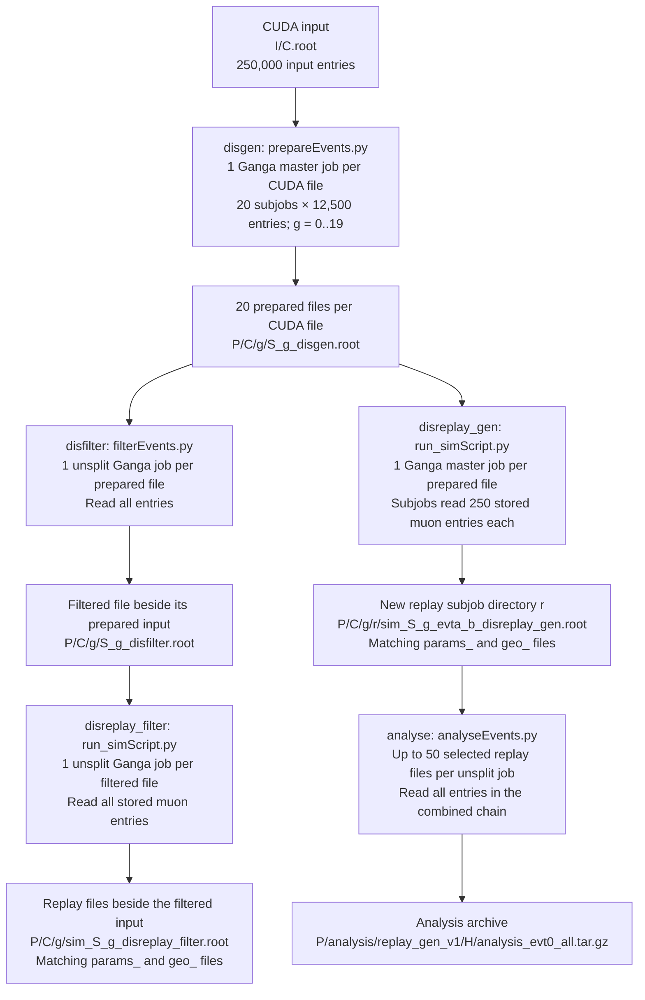

# Ganga DIS production: input and output directory flow

This diagram describes `gangaProdScript.py` for production `261017`,
with one job per input file for the generation and replay stages,
250,000 CUDA input entries per generation job, 12,500 entries per generation
subjob, and 250 input muon entries per unfiltered replay subjob. Analysis groups
up to 50 replay files into one unsplit job and writes a `.tar.gz` archive.
The optional filtering branch illustrates filtering and filtered replay with
one unsplit job per input file. Each stage is launched separately; arrows show
file dependencies, not automatic job scheduling.

## Path and range notation

| Symbol | Meaning |
| --- | --- |
| `I` | `/eos/experiment/ship/simulation/cuda_muons/try_2026_MS5` |
| `P` | `/eos/experiment/ship/user/ammagnan/MuonDIS/TRY2026/261017` = `output_base/tag/production` |
| `C` | Input CUDA filename without `.root`, e.g. `sim_<uuid>` |
| `g` | Generation Ganga subjob ID, `0..19` |
| `A`, `B` | CUDA input range: `A = 12500*g`, `B = A+12500` |
| `S_g` | `muonDis_cudaMu_TRY2026_evtA_B`, substituting the numeric range |
| `r` | Replay Ganga subjob ID, starting at `0` independently for each replay job |
| `a`, `b` | Replay input range: `a = 250*r`, `b = min(a+250, E)`, for configured replay span `E` |
| `H` | First 20 hexadecimal characters of the SHA-256 hash identifying the ordered absolute input paths in an analysis group |
| `L` | `~/gangadir/workspace/ammagnan/LocalXML` |

The `evtSTART_END` filename ranges have an **exclusive end**. Thus
`evt12500_25000` reads CUDA entries 12,500 through 24,999. A replay range is
relative to the prepared input file's stored muon entries, not to the original
CUDA file and not to individual DIS interactions.
For the last subjob of a split job, the current planner uses `all` instead of
the numeric end and reads to the end of the input.

## Functional diagram



Every successful replay execution writes three ROOT files: `sim_` contains the simulation,
`params_` the parameters, and `geo_` the geometry. All three share the same stem
and stage suffix. The old terminal suffix is replaced: `_disgen` becomes
`_disfilter` or `_evt<a>_<b>_disreplay_gen`; `_disfilter` becomes
`_disreplay_filter` when reading the entire filtered file.

## Concrete EOS tree for one CUDA input

For input `I/sim_<uuid>.root`, the following example expands generation subjob
`g=1` and replay subjobs `r=0,1`. Angle-bracket placeholders are descriptive;
the actual CUDA UUID is retained in the directory name.

```text
/eos/experiment/ship/user/ammagnan/MuonDIS/TRY2026/261017/
├── analysis/
│   └── replay_gen_v1/                       # analysis_name
│       ├── <source-group-hash>/             # H: up to 50 selected replay files
│       │   └── analysis_evt0_all.tar.gz     # complete analysis output directory
│       └── ...                             # further analysis groups
└── sim_<uuid>/
    ├── 0/                                  # generation subjob g=0
    │   ├── muonDis_cudaMu_TRY2026_evt0_12500_disgen.root
    │   └── ...                             # same downstream structure as g=1
    ├── 1/                                  # generation subjob g=1
    │   ├── muonDis_cudaMu_TRY2026_evt12500_25000_disgen.root
    │   ├── muonDis_cudaMu_TRY2026_evt12500_25000_disfilter.root
    │   ├── sim_muonDis_cudaMu_TRY2026_evt12500_25000_disreplay_filter.root
    │   ├── params_muonDis_cudaMu_TRY2026_evt12500_25000_disreplay_filter.root
    │   ├── geo_muonDis_cudaMu_TRY2026_evt12500_25000_disreplay_filter.root
    │   ├── 0/                              # unfiltered replay subjob r=0
    │   │   ├── sim_muonDis_cudaMu_TRY2026_evt12500_25000_evt0_250_disreplay_gen.root
    │   │   ├── params_muonDis_cudaMu_TRY2026_evt12500_25000_evt0_250_disreplay_gen.root
    │   │   └── geo_muonDis_cudaMu_TRY2026_evt12500_25000_evt0_250_disreplay_gen.root
    │   ├── 1/                              # unfiltered replay subjob r=1
    │   │   ├── sim_muonDis_cudaMu_TRY2026_evt12500_25000_evt250_500_disreplay_gen.root
    │   │   ├── params_muonDis_cudaMu_TRY2026_evt12500_25000_evt250_500_disreplay_gen.root
    │   │   └── geo_muonDis_cudaMu_TRY2026_evt12500_25000_evt250_500_disreplay_gen.root
    │   └── ...                             # further replay subjob IDs
    ├── ...                                 # generation subjobs 2..18
    └── 19/                                 # generation subjob g=19
        ├── muonDis_cudaMu_TRY2026_evt237500_all_disgen.root
        └── ...
```

`P/C/g` is preserved by filtering and replay. Unsplit filtering and filtered
replay add no directory for their own Ganga job ID, and no extra `/0/`.
Unfiltered replay adds `/r/` because it is split. Ganga master job IDs are not
part of these EOS paths.

The `C` directory above assumes flat CUDA inputs under `I`. For nested inputs,
the planner preserves their relative parent directory. It appends the input
stem if multiple matching inputs share that parent; a nested directory with
only one matching input does not receive the extra stem level.

## Analysis archives

The current [analyse.yaml](analyse.yaml) selects `sim_*_disreplay_gen.root`
under `P`, with `files_per_job: 50`, `n_subjobs: 1`, `events_per_file: -1`,
`first_event: 0`, and `analysis_name: replay_gen_v1`. Groups follow the sorted
input selection and can span CUDA inputs or generation subjobs; the last group
may contain fewer than 50 files. Analysis outputs therefore live under
`P/analysis/`, rather than beside one particular replay input.

The general output path is:

```text
P/analysis/<analysis_name>/<source-group-hash>/[subjob-id]/analysis_evtSTART_END.tar.gz
```

The optional subjob directory appears only when analysis is split. Its entry
ranges apply to the combined chain, not separately to each input file.
With the current unsplit settings the archive is `analysis_evt0_all.tar.gz`.
A `--test` run uses one input file and produces `analysis_evt0_100.tar.gz`;
an existing example in this production is:

```text
P/analysis/replay_gen_v1/b53205d1013c1b5ab80d/analysis_evt0_100.tar.gz
```

Each replay-analysis archive contains:

```text
analysis_evt0_all/
├── run.json                                # completion, settings and source ranges
├── histograms.npz
├── histogram_flows.csv
├── normalization.csv
├── cutflow.csv
├── pair_cutflow.csv
├── pair_composition_cutflow.csv
├── pairs.csv
└── plots/                                  # only when save_plots: true
```

The current configuration has `save_plots: false`, so plots are rendered later
when merging. The directory inside a test archive is `analysis_evt0_100/`.
The worker packages the whole output directory after analysis completes, and
Ganga transfers the archive to EOS. See [README.md](README.md) for checking and
merging analysis archives.

## Ganga jobs and local logs

Every downstream input file, or input group for analysis, creates a new,
independent Ganga job ID. Denote these IDs by `Jgen`, `Jfilter(g)`,
`Jreplay(g)`, `Jreplay_filter(g)` and `Janalysis(H)`; the symbols are not literal
directory names and do not imply consecutive IDs.

| Stage | Jobs per original CUDA input | Local stdout path |
| --- | --- | --- |
| `disgen` | 1 master job, 20 subjobs | `L/Jgen/g/output/stdout` |
| `disfilter` | 20 unsplit jobs, one for each prepared file | `L/Jfilter(g)/output/stdout` |
| `disreplay_gen` | 20 master jobs, one for each prepared file | `L/Jreplay(g)/r/output/stdout` |
| `disreplay_filter` | 20 unsplit jobs, one for each filtered file | `L/Jreplay_filter(g)/output/stdout` |
| `analyse` | One unsplit job per group of up to 50 selected replay files across the production | `L/Janalysis(H)/output/stdout` |

The per-CUDA counts assume all upstream files were produced and `n_jobs: -1`. The
numeric `g` retained in EOS is the original generation subjob ID. It is not a
subjob ID of the later unsplit filter or filtered-replay job.

## Settings corresponding to the diagram

Use the same production root for all stages, `first_event: 0`, and `n_jobs: -1`.
The following are the splitting settings for this scenario, not edits to the
existing YAML files:

| Setting | `disgen` | `disfilter` | `disreplay_gen` | `disreplay_filter` |
| --- | --- | --- | --- | --- |
| `input_dir` | `I` | `P` (default) | `P` (default) | `P` (default) |
| `input_pattern` | `*sim_*.root` | `*_disgen.root` | `*_disgen.root` | `*_disfilter.root` |
| `events_per_file` | `250000` | `-1` | `E`, the chosen prepared-entry span | `-1` |
| `events_per_subjob` | `12500` | omitted | `250` | omitted |
| `n_subjobs` | `20` or omitted | `1` | omitted; computed from `E/250`, rounded up | `1` |

Generation can skip input muons, so a 12,500-entry CUDA range can produce fewer
than 12,500 stored muon entries. The planner does not open ROOT files to discover
their entry counts; its `events_per_file` setting applies to every selected
file. Choose replay spans for the stored counts, using separate selections or
configurations when needed. Setting `E=12500` schedules 50 replay subjobs per
prepared file (`r=0..49`), or 1,000 replay subjobs per original CUDA input; this
is a configured span, not a guarantee that every prepared file contains that
many muons. When there are multiple subjobs, the last uses `-n -1` from its
calculated start to include all remaining entries, even beyond `E`; its output
name uses `all` as the range end.

The current `disgen.yaml` specifies `production: 261017`, `n_jobs: 40`,
`n_subjobs: 20`, and `events_per_file: 250000`. The current
`disreplay_gen.yaml` also uses `261017`, with `n_jobs: 20`, `n_subjobs: 50`,
and `events_per_file: 12500`. These job limits select new master jobs per
invocation; they do not change the directory layout.

The filtering branch above is illustrative: `disfilter.yaml` and
`disreplay_filter.yaml` still target `261009`. The latter currently uses two
subjobs over 10,000 entries, rather than the unsplit layout shown here. To use
that branch as drawn, select production `261017` and the unsplit settings in
the table. This document does not change the YAML files.

The layout follows `event_ranges()`, `production_stem()`, `plan_jobs()` and
`prepare_jobs()` in [gangaProdScript.py](../gangaProdScript.py).
