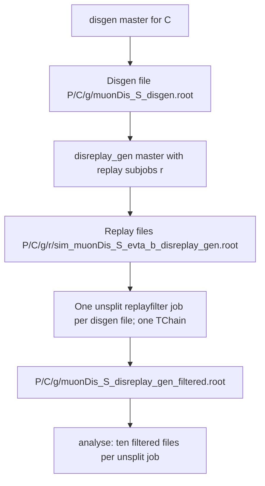

# DIS production and chained replay filtering

Let `P = output_base/tag/production` (261021 in the supplied replay/filter/analysis
YAMLs), `C` identify a CUDA input, `g` a generation subjob, and `r` a replay subjob.



```text
P/
├── C/
│   └── g/
│       ├── muonDis_S_disgen.root
│       ├── 0/
│       │   ├── sim_muonDis_S_evt0_1000_disreplay_gen.root
│       │   └── geo_muonDis_S_evt0_1000_disreplay_gen.root
│       ├── 1/
│       │   ├── sim_muonDis_S_evt1000_all_disreplay_gen.root
│       │   └── geo_muonDis_S_evt1000_all_disreplay_gen.root
│       ├── muonDis_S_disreplay_gen_filtered.root
│       ├── geo_muonDis_S_disreplay_gen_filtered.root
│       └── muonDis_S_disreplay_gen_filtered.json
└── analysis/replay_gen_v6/
    └── <ordered-source-path-hash>/
        └── analysis_evt0_all.tar.gz
```

A filter job has **no Ganga subjobs**. It consumes all replay files belonging
to one prepared file, including all replay splits. It retains the prepared
file's directory and basename, replacing `_disgen` with `_disreplay_gen_filtered`.
Its local log is `GANGADIR/<filter-job-id>/output/stdout`.

The companion geometry is copied once after verifying consistency across the
chain. ROOT schemas must match. Output tree normalization combines records
from every input without counting shared preparation records more than once.
Per-source UUIDs, ranges and counts are saved in the JSON manifest; auxiliary
ROOT objects are retained in `replay_sources/<source-index>/`.

`masters_per_job: 10` now means ten filter jobs' outputs, hence ten disgen files.
Analysis discovers the new suffix under `P` and stages aliases for FairShip.
A final analysis job may contain fewer than ten files. Use a state file to
freeze groups when running in batches; choose a fresh state for this layout.

`--test` reads at most 100 chain entries and writes
`muonDis_S_disreplay_gen_filtered_test.root` beside the prepared file.
Normal analysis discovery excludes test outputs. `checkReplayFilter.py` reports transfer
completeness, event efficiency and ROOT byte reduction. `checkAnalysis.py`
checks version-6 archives, including empty `events.jsonl`, and supports
`--skip-event-records` for summary-only merging. See [README.md](README.md).
