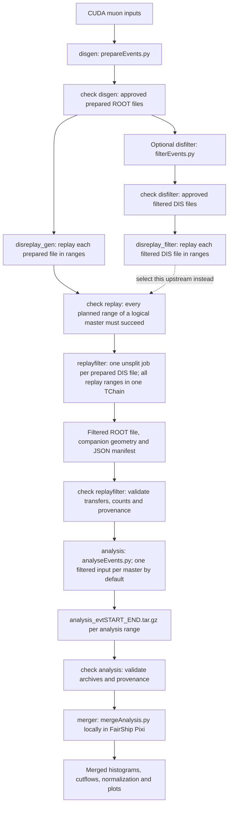

# DIS analysis workflow and output layout

This diagram describes the current [prodWorkflow setup](../prodWorkflow/README.md),
configured by `prodWorkflow/workflow.yaml` and the stage YAMLs beside it.
Both `gangaSubmit.sh` entry points use this workflow. Older `production/*.yaml`
examples use a different configuration and directory layout.



Each `check` writes `checked.json`; the next stage consumes only that saved,
approved input list. Only disgen discovers files. By default,
`require_complete: true` waits for all planned upstream ranges. Even with
`require_complete: false`, replayfilter never receives an incomplete replay
master. Successful retry ranges can complete a logical master across several
Ganga job IDs.

The default replayfilter upstream is `disreplay_gen`. To use the optional branch,
set `upstream: disreplay_filter` before submission. The two replay branches are
alternatives for one replayfilter stage; running both requires separately named
replayfilter, analysis and merger stages as described in the workflow README.

Replayfilter combines all checked replay splits from one prepared DIS file.
It preserves accepted events' branches and deduplicates shared preparation
normalization. ROOT schemas and companion geometries must agree across the
chain. The JSON manifest records source provenance and selection counts;
auxiliary ROOT objects are retained under `replay_sources/<source-index>/`.

Analysis inherits the replay type from the checked filter provenance. Its
default is one filtered input per Ganga master, with one range; set
`events_per_subjob` or `n_subjobs` to split that input further. Each archive
includes `events.jsonl`. The local merger defaults to `skip_event_records: true`
and `save_plots: true`, retaining the original archives while merging summaries
and rendering plots.

Let `P = OUTPUT_BASE/TAG/PRODUCTION/MODE`, where `MODE` is `production` or `test`.
`STEP_NAME` defaults to the stage name, and `GROUP`, `ATTEMPT` and `RANGE` are
workflow identifiers. Each batch attempt has its own output directory:

```text
P/
├── disgen/GROUP/ATTEMPT/RANGE/
│   └── muonDis_TAG_GROUP_evtSTART_END_disgen.root
├── disreplay_gen/GROUP/ATTEMPT/RANGE/
│   ├── sim_muonDis_TAG_GROUP_evtSTART_END_disreplay_gen.root
│   ├── params_muonDis_TAG_GROUP_evtSTART_END_disreplay_gen.root
│   └── geo_muonDis_TAG_GROUP_evtSTART_END_disreplay_gen.root
├── replayfilter/GROUP/ATTEMPT/RANGE/
│   ├── muonDis_TAG_GROUP_evtSTART_END_disreplay_gen_filtered.root
│   ├── geo_muonDis_TAG_GROUP_evtSTART_END_disreplay_gen_filtered.root
│   └── muonDis_TAG_GROUP_evtSTART_END_disreplay_gen_filtered.json
├── analysis/GROUP/ATTEMPT/RANGE/
│   └── analysis_evtSTART_END.tar.gz
└── merger/
    ├── merged/
    └── merged_inputs/

STATE_DIR/TAG/PRODUCTION/MODE/STEP_NAME/
├── state.json
├── checked.json                  # Written by check for batch stages
└── tasks/ATTEMPT/task-UNIT.json
```

The optional branch adds `disfilter` and `disreplay_filter` stage directories;
its replayfilter outputs use `_disreplay_filter_filtered` instead. Custom stage
names replace the corresponding directory names. Retries write fresh attempt
directories, and the checker exports only the newest accepted attempt per range.
Ganga IDs and subjob IDs are recorded in state; they are not the output path IDs.

`--test` uses separate state and output directories, selects one input/master,
and processes at most 100 entries (2 for replay). Replayfilter remains unsplit.
Test and production checker exports cannot be mixed.
