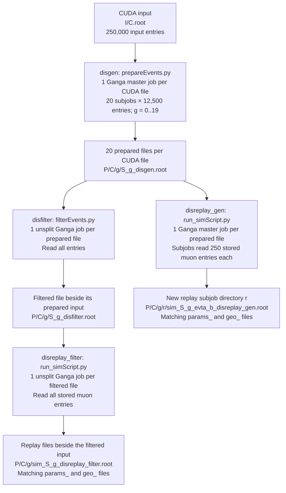

# Ganga DIS production: input and output directory flow

This diagram describes `gangaProdScript.py` with one job per input file,
250,000 CUDA input entries per generation job, 12,500 entries per generation
subjob, and 250 input muon entries per unfiltered replay subjob. Filtering and
filtered replay each use one unsplit job per input file. Each stage is launched
separately; arrows show file dependencies, not automatic job scheduling.

## Path and range notation

| Symbol | Meaning |
| --- | --- |
| `I` | `/eos/experiment/ship/simulation/cuda_muons/try_2026_MS5` |
| `P` | `/eos/experiment/ship/user/ammagnan/MuonDIS/TRY2026/261009` = `output_base/tag/production` |
| `C` | Input CUDA filename without `.root`, e.g. `sim_<uuid>` |
| `g` | Generation Ganga subjob ID, `0..19` |
| `A`, `B` | CUDA input range: `A = 12500*g`, `B = A+12500` |
| `S_g` | `muonDis_cudaMu_TRY2026_evtA_B`, substituting the numeric range |
| `r` | Replay Ganga subjob ID, starting at `0` independently for each replay job |
| `a`, `b` | Replay input range: `a = 250*r`, `b = min(a+250, E)`, for configured replay span `E` |
| `L` | `~/gangadir/workspace/ammagnan/LocalXML` |

The `evtSTART_END` filename ranges have an **exclusive end**. Thus
`evt12500_25000` reads CUDA entries 12,500 through 24,999. A replay range is
relative to the prepared input file's stored muon entries, not to the original
CUDA file and not to individual DIS interactions.

## Functional diagram



Every replay execution writes three ROOT files: `sim_` contains the simulation,
`params_` the parameters, and `geo_` the geometry. All three share the same stem
and stage suffix. The old terminal suffix is replaced: `_disgen` becomes
`_disfilter` or `_evt<a>_<b>_disreplay_gen`; `_disfilter` becomes
`_disreplay_filter` when reading the entire filtered file.

## Concrete EOS tree for one CUDA input

For input `I/sim_<uuid>.root`, the following example expands generation subjob
`g=1` and replay subjobs `r=0,1`. Angle-bracket placeholders are descriptive;
the actual CUDA UUID is retained in the directory name.

```text
/eos/experiment/ship/user/ammagnan/MuonDIS/TRY2026/261009/
└── sim_<uuid>/
    ├── 0/                                  # generation subjob g=0
    │   ├── muonDis_cudaMu_TRY2026_evt0_12500_disgen.root
    │   └── ...                             # same downstream structure as g=1
    ├── 1/                                  # generation subjob g=1
    │   ├── muonDis_cudaMu_TRY2026_evt12500_25000_disgen.root
    │   ├── muonDis_cudaMu_TRY2026_evt12500_25000_disfilter.root
    │   ├── sim_muonDis_cudaMu_TRY2026_evt12500_25000_disreplay_filter.root
    │   ├── params_muonDis_cudaMu_TRY2026_evt12500_25000_disreplay_filter.root
    │   ├── geo_muonDis_cudaMu_TRY2026_evt12500_25000_disreplay_filter.root
    │   ├── 0/                              # unfiltered replay subjob r=0
    │   │   ├── sim_muonDis_cudaMu_TRY2026_evt12500_25000_evt0_250_disreplay_gen.root
    │   │   ├── params_muonDis_cudaMu_TRY2026_evt12500_25000_evt0_250_disreplay_gen.root
    │   │   └── geo_muonDis_cudaMu_TRY2026_evt12500_25000_evt0_250_disreplay_gen.root
    │   ├── 1/                              # unfiltered replay subjob r=1
    │   │   ├── sim_muonDis_cudaMu_TRY2026_evt12500_25000_evt250_500_disreplay_gen.root
    │   │   ├── params_muonDis_cudaMu_TRY2026_evt12500_25000_evt250_500_disreplay_gen.root
    │   │   └── geo_muonDis_cudaMu_TRY2026_evt12500_25000_evt250_500_disreplay_gen.root
    │   └── ...                             # further replay subjob IDs
    ├── ...                                 # generation subjobs 2..18
    └── 19/                                 # generation subjob g=19
        ├── muonDis_cudaMu_TRY2026_evt237500_250000_disgen.root
        └── ...
```

`P/C/g` is preserved by all downstream stages. Unsplit filtering and filtered
replay add no directory for their own Ganga job ID, and no extra `/0/`.
Unfiltered replay adds `/r/` because it is split. Ganga master job IDs are not
part of these EOS paths.

The `C` directory above assumes flat CUDA inputs under `I`. For nested inputs,
the planner preserves their relative parent directory. It appends the input
stem if multiple matching inputs share that parent; a nested directory with
only one matching input does not receive the extra stem level.

## Ganga jobs and local logs

Every downstream file creates a new, independent Ganga job ID. Denote these IDs
by `Jgen`, `Jfilter(g)`, `Jreplay(g)` and `Jreplay_filter(g)`; the symbols are not
literal directory names and do not imply consecutive IDs.

| Stage | Jobs per original CUDA input | Local stdout path |
| --- | --- | --- |
| `disgen` | 1 master job, 20 subjobs | `L/Jgen/g/output/stdout` |
| `disfilter` | 20 unsplit jobs, one for each prepared file | `L/Jfilter(g)/output/stdout` |
| `disreplay_gen` | 20 master jobs, one for each prepared file | `L/Jreplay(g)/r/output/stdout` |
| `disreplay_filter` | 20 unsplit jobs, one for each filtered file | `L/Jreplay_filter(g)/output/stdout` |

These counts assume all upstream files were produced and `n_jobs: -1`. The
numeric `g` retained in EOS is the original generation subjob ID. It is not a
subjob ID of the later unsplit filter or filtered-replay job.

## Settings corresponding to the diagram

Use the same production root for all stages, `first_event: 0`, and `n_jobs: -1`.
The following are the splitting settings for this scenario, not edits to the
existing YAML files:

| Setting | `disgen` | `disfilter` | `disreplay_gen` | `disreplay_filter` |
| --- | --- | --- | --- | --- |
| `input_dir` | `I` | `P` (default) | `P` (default) | `P` (default) |
| `input_pattern` | `*sim_*.root` | `*_disgen.root` | `*_disgen.root` | `*_disfilter.root` |
| `events_per_file` | `250000` | `-1` | `E`, the chosen prepared-entry span | `-1` |
| `events_per_subjob` | `12500` | omitted | `250` | omitted |
| `n_subjobs` | `20` or omitted | `1` | omitted; computed from `E/250`, rounded up | `1` |

Generation can skip input muons, so a 12,500-entry CUDA range can produce fewer
than 12,500 stored muon entries. The planner does not open ROOT files to discover
their entry counts; its `events_per_file` setting applies to every selected
file. Choose replay spans for the stored counts, using separate selections or
configurations when needed. Setting `E=12500` schedules 50 replay subjobs per
prepared file (`r=0..49`), or 1,000 replay subjobs per original CUDA input; this
is a configured span, not a guarantee that every prepared file contains that
many muons. When there are multiple subjobs, the last uses `-n -1` from its
calculated start to include all remaining entries, even beyond `E`; its output
name uses `all` as the range end.

The current `disgen.yaml` specifies 10 subjobs over 250,000 entries; the requested
diagram instead uses 20. The current `disreplay_gen.yaml` specifies
`n_jobs: 1`, `n_subjobs: 100`, and `events_per_file: 25000`; replace those settings
with the appropriate selection and span to implement this scenario.

The layout follows `event_ranges()`, `production_stem()`, `plan_jobs()` and
`prepare_jobs()` in [gangaProdScript.py](../gangaProdScript.py).
